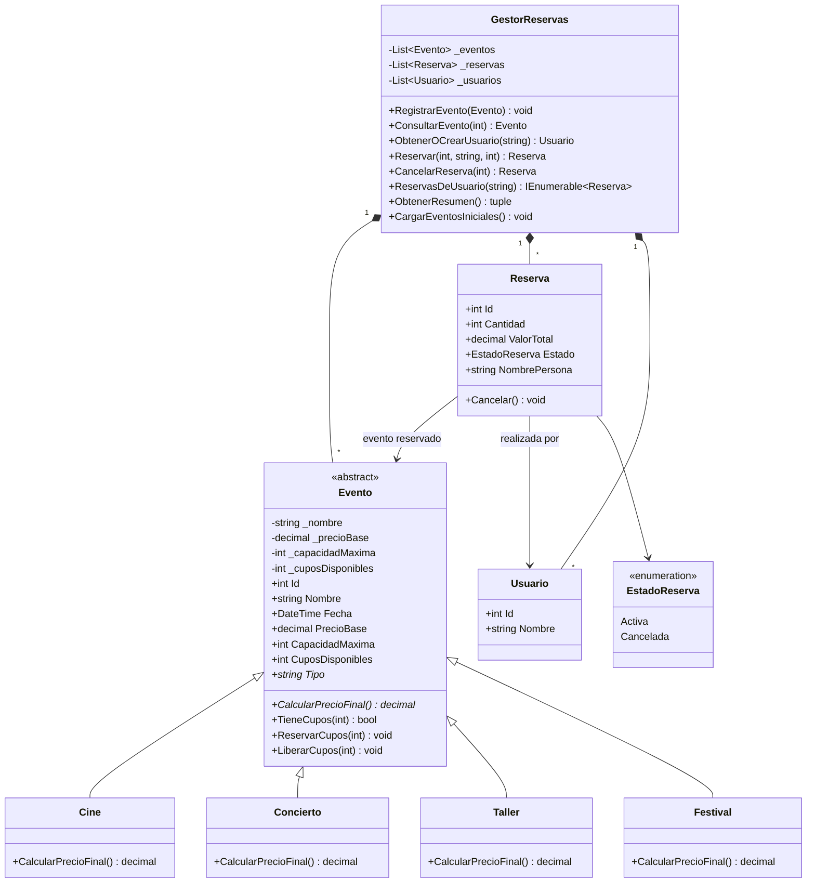

# PLANAZO — Sistema de reservas de eventos (POO en C#)

**Autor:** Carlos David Ariza Ospino
**Asignatura:** Programación con C# y .NET — Parcial de Programación Orientada a Objetos
**Tipo:** Aplicación de consola (.NET)

## 1. Descripción

PLANAZO es una empresa que organiza conciertos, funciones de cine y talleres. Esta aplicación de consola permite consultar los eventos, reservar entradas, controlar los cupos disponibles y cancelar reservas, aplicando los principios de la Programación Orientada a Objetos.

## 2. Funcionalidades

- Ver todos los eventos con su precio final y cupos disponibles.
- Consultar un evento por id (muestra precio base y precio final).
- Reservar entradas (valida cantidad, cupos y nombre).
- Ver todas las reservas realizadas.
- Cancelar una reserva (devuelve los cupos; no permite cancelar dos veces).
- Resumen de reservas activas: cantidad de reservas, entradas y valor total.
- **Reto 2:** ver todas las reservas de un usuario (opción 7 del menú).
- **Reto 1:** nuevo tipo de evento `Festival`.
- **Reto 3:** diagrama UML (sección 5).
- Los errores se capturan con excepciones y el programa nunca se cierra inesperadamente.

Eventos iniciales: 2 de cine, 2 conciertos, 2 talleres y 1 festival.

## 3. Cómo ejecutar

Requisitos: [.NET SDK 8.0](https://dotnet.microsoft.com/download) o superior.

```bash
git clone https://github.com/<tu-usuario>/PLANAZO-POO-CSharp.git
cd PLANAZO-POO-CSharp
dotnet run
```

> Si tienes instalado otro SDK (por ejemplo .NET 9 o 10), cambia `<TargetFramework>net8.0</TargetFramework>` en `PLANAZO-POO-CSharp.csproj` por tu versión.

## 4. Estructura y clases

```text
PLANAZO-POO-CSharp/
├── Program.cs                 Menú de consola (solo interacción con el usuario)
├── Modelos/
│   ├── Evento.cs              Clase abstracta base
│   ├── Cine.cs                Precio base
│   ├── Concierto.cs           Precio base + 15 %
│   ├── Taller.cs              Precio base - 10 %
│   ├── Festival.cs            Reto 1: precio base + 25 % + $10.000
│   ├── Usuario.cs             Reto 2: persona que reserva
│   ├── Reserva.cs             Asocia Usuario + Evento
│   ├── EstadoReserva.cs       Enum Activa / Cancelada
│   └── Formato.cs             Formato de moneda ($57.500)
├── Servicios/
│   └── GestorReservas.cs      Lógica de negocio y listas
├── Capturas/                  Evidencias de las pruebas
├── README.md
└── .gitignore
```

| Clase | Responsabilidad |
|---|---|
| `Evento` (abstracta) | Id, nombre, fecha, precio base, capacidad y cupos. Define `CalcularPrecioFinal()` abstracto y controla `ReservarCupos` / `LiberarCupos`. |
| `Cine`, `Concierto`, `Taller`, `Festival` | Heredan de `Evento` e implementan su propia regla de precio. |
| `Usuario` | Identifica a la persona que reserva. |
| `Reserva` | Une un `Usuario` con un `Evento`; guarda cantidad, valor total y estado; sabe cancelarse. |
| `GestorReservas` | Guarda `List<Evento>`, `List<Reserva>` y `List<Usuario>`; valida y ejecuta reservar, cancelar, consultar y resumir. |
| `Program` | Muestra el menú y captura las excepciones. |

**Relaciones:** `GestorReservas` *contiene* (composición) eventos, reservas y usuarios. Cada `Reserva` *se asocia* con un `Usuario` y un `Evento`. `Cine`, `Concierto`, `Taller` y `Festival` *heredan* de `Evento`.

### Dónde se aplica cada concepto

- **Encapsulamiento:** en `Evento`, los campos `_nombre`, `_precioBase`, `_capacidadMaxima` y `_cuposDisponibles` son privados. `CuposDisponibles` solo tiene `get`; únicamente cambia mediante `ReservarCupos()` y `LiberarCupos()`, que validan los valores. `Reserva.Estado` tiene `private set` y solo cambia con `Cancelar()`. `GestorReservas` expone sus listas como `IReadOnlyList<T>`.
- **Abstracción:** `Evento` es `abstract`; no se puede instanciar y obliga a las hijas a implementar `CalcularPrecioFinal()` y `Tipo`.
- **Herencia:** `Cine`, `Concierto`, `Taller` y `Festival` reutilizan de `Evento` el id, nombre, fecha, cupos y validaciones mediante `: base(...)`.
- **Polimorfismo:** `Reserva` calcula `evento.CalcularPrecioFinal()` sin saber qué tipo de evento es; cada objeto responde con su propia regla (`Concierto` → 57.500 si el base es 50.000).
- **Constructores:** inicializan y validan cada objeto (`Reserva` rechaza cantidades ≤ 0, `Evento` rechaza nombres vacíos, etc.).
- **Colecciones:** `List<Evento>`, `List<Reserva>` y `List<Usuario>` en `GestorReservas`.
- **Excepciones:** `ArgumentException`, `ArgumentOutOfRangeException`, `InvalidOperationException` y `KeyNotFoundException`, capturadas en `Program.cs`.
- **`decimal`:** todos los valores monetarios usan `decimal`.

## 5. Diagrama UML de clases (Reto 3)

Un diagrama de clases UML representa las clases de un sistema (con sus atributos y métodos) y las relaciones entre ellas: herencia, asociación y composición.



## 6. Casos de prueba

Las capturas están en la carpeta `Capturas/`.

| # | Caso | Resultado esperado | Captura |
|---|---|---|---|
| 1 | Registrar una reserva válida | Reserva creada, cupos disminuyen | `Capturas/01-reserva-valida.png` |
| 2 | Reservar más entradas que los cupos | Mensaje "No hay cupos suficientes" | `Capturas/02-sin-cupos.png` |
| 3 | Reservar con cantidad negativa | Mensaje de error, no se crea la reserva | `Capturas/03-cantidad-negativa.png` |
| 4 | Cancelar y verificar cupos devueltos | Reserva cancelada, cupos restaurados | `Capturas/04-cancelar.png` |
| 5 | Cancelar dos veces la misma reserva | Mensaje "ya fue cancelada" | `Capturas/05-doble-cancelacion.png` |
| 6 | Consultar un evento inexistente | Mensaje "No existe ningún evento" | `Capturas/06-evento-inexistente.png` |
| 7 | Precio final de cada tipo | Cine = base, Concierto = +15 %, Taller = -10 %, Festival = +25 % + $10.000 | `Capturas/07-precios.png` |

Precios iniciales: Cine 18.000 → **18.000**; Concierto 50.000 → **57.500**; Taller 60.000 → **54.000**; Festival 70.000 → **97.500**.

## 7. Pregunta de sustentación

**¿Por qué utilizaste una clase abstracta `Evento` en lugar de crear clases completamente independientes para Cine, Concierto y Taller? ¿Qué ventajas tiene esta decisión cuando necesitamos agregar un nuevo tipo de evento?**

Usé una clase abstracta porque Cine, Concierto y Taller comparten casi todo: id, nombre, fecha, precio base, capacidad, cupos y las reglas para reservar y liberar cupos. Con clases independientes habría tenido que copiar ese código tres veces, y cualquier cambio (por ejemplo, validar mejor los cupos) habría que repetirlo en cada una. En `Evento.cs` escribí esa lógica una sola vez, y las hijas la heredan con `: base(...)`.

Lo único que cambia entre eventos es el cálculo del precio, y por eso `CalcularPrecioFinal()` es `abstract`: cada clase hija está obligada a implementarlo. En `Concierto` es `PrecioBase * (1 + Recargo)` y en `Taller` es `PrecioBase * (1 - Descuento)`.

Otra ventaja es el polimorfismo. `Reserva` y `GestorReservas` trabajan con el tipo `Evento` y llaman a `evento.CalcularPrecioFinal()` sin preguntar si es cine, concierto o taller. Además, una sola `List<Evento>` puede guardar todos los tipos.

Al agregar un nuevo tipo basta con crear una clase que herede de `Evento` e implemente su precio. Eso hice con `Festival` (Reto 1): no modifiqué `Cine`, `Concierto`, `Taller`, `Reserva` ni `Program.cs`; solo creé `Festival.cs` y lo registré en `GestorReservas.CargarEventosIniciales()`. Esto respeta el principio abierto/cerrado: el sistema se extiende sin modificar el código que ya funciona. Si el compilador detecta que una clase hija no implementa `CalcularPrecioFinal()`, falla, así que nadie puede olvidar la regla de precio de un nuevo tipo.
